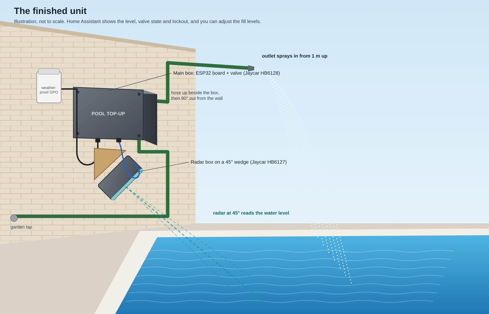
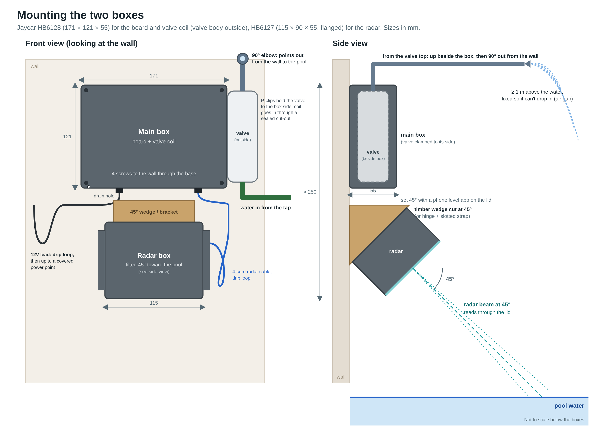
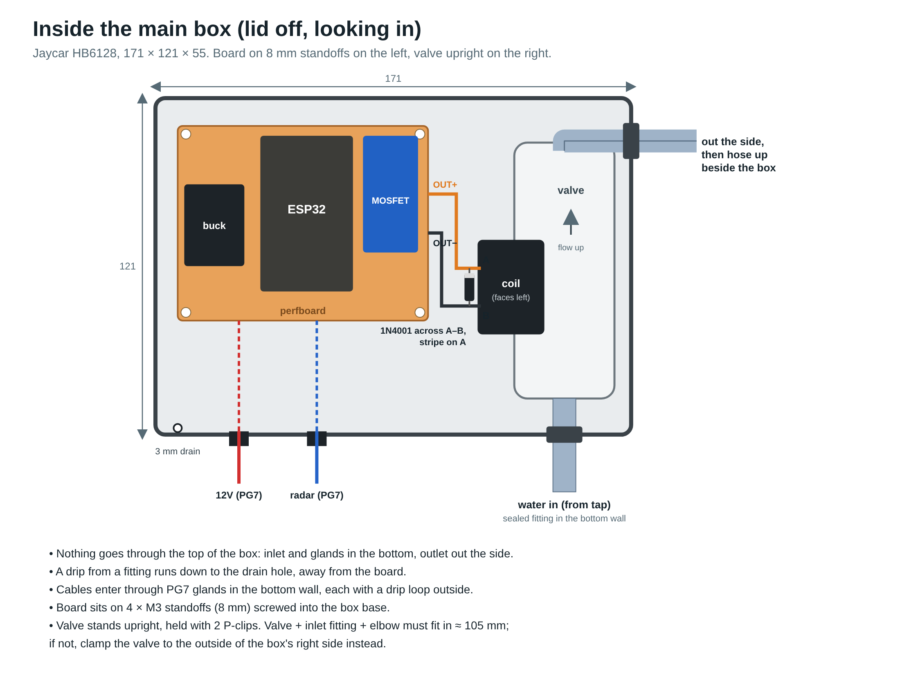

# IoT pool water refill: a Home Assistant pool top-up

An automatic pool top-up controller that **integrates with Home Assistant**. An 80 GHz radar measures the distance to the water. When the level drops, an ESP32 running **ESPHome** opens a 12V solenoid valve until the pool is back up.

It is added to Home Assistant through the ESPHome integration, so the level, the valve and every setting appear as Home Assistant entities. You can watch the level on a dashboard, open or close the valve, change the fill levels, and get a notification if the safety cut-off fires. The top-up logic runs on the ESP32 itself, so it keeps working even if Home Assistant is down.

**Guides:** [Parts and tools](docs/PARTS.md) · [Build guide](docs/BUILD.md) · [Adding it to Home Assistant with ESPHome](docs/ESPHOME.md) · [Drilling template (PDF)](mounting/drilling-template.pdf)

## How it works

- The radar is mounted above the pool, tilted at 45°, and reports the distance to the water every 10 seconds over Modbus-RTU.
- Readings are median-filtered to ignore splashes and ripples.
- When the distance stays above **Start Fill Above** for 2 minutes, the valve opens.
- The valve closes when the distance drops below **Stop Fill Below**.
- Safety:
  - The valve is forced closed after **Max Fill Time** (default 60 min) and the system locks out until you press **Reset Fill Lockout** in Home Assistant.
  - The valve closes if the radar stops reporting for 60 seconds.
  - There is a 30-minute rest between fills.
  - The valve always starts closed after a power cut.
- The outlet sprays from about 1 m above the pool. That air gap is the backflow protection, so the outlet must never be able to end up in the water.

## Parts (about $410 AUD)

The full parts and tools list, with shop codes, is in **[docs/PARTS.md](docs/PARTS.md)**. The main items are an ESP32, a DFRobot SEN0676 radar, a 12V 3/4" solenoid valve, an HW-517 MOSFET module, a DFR1015 buck converter, a 12V 2A plugpack, and two Jaycar boxes (HB6128 and HB6127).

## Wiring

See [`wiring/one-board-layout.png`](wiring/one-board-layout.png) for the top view and the solder side. In summary:

| From | To |
|---|---|
| 12V + | buck IN+, MOSFET VIN+ |
| 12V − | GND bus, buck IN−, MOSFET VIN− |
| Buck OUT+ (5V) | 5V bus → ESP32 VIN, radar 5V |
| Buck OUT− | GND bus |
| ESP32 GPIO16 (RX2) | radar TX |
| ESP32 GPIO17 (TX2) | radar RX |
| ESP32 GPIO23 (D23) | MOSFET PWM |
| MOSFET OUT+ / OUT− | valve terminals A / B |
| 1N4001 | across the valve coil tabs, stripe on A (OUT+ side) |

12V only goes to the buck and the MOSFET, never to the ESP32. A diode fitted backwards shorts the 12V, so check the stripe before powering up.

Power-up order: power the board with only the buck plugged in and measure 5V on the 5V bus. Only then plug in the ESP32, the MOSFET and the radar.

## Home Assistant

| In Home Assistant | What it does |
|---|---|
| **Distance** sensor | radar to water, in cm (goes up as the pool drops) |
| **Fill Valve** switch | open or close the valve by hand |
| **Auto Top-Up** switch | turn automatic filling on or off |
| **Start Fill Above** / **Stop Fill Below** | the fill levels, adjustable from the dashboard |
| **Max Fill Time** | safety cut-off, in minutes |
| **Fill Lockout** / **Reset Fill Lockout** | shows when the cut-off fired, and clears it |

You need Home Assistant with the **ESPHome Device Builder** add-on (or ESPHome on a PC). Full setup steps are in [docs/ESPHOME.md](docs/ESPHOME.md).

## Firmware

ESPHome config: [`esphome/pool-level.yaml`](esphome/pool-level.yaml). For step-by-step setup in Home Assistant, including how to set the fill levels, see [docs/ESPHOME.md](docs/ESPHOME.md).

## Enclosure and mounting

- The main box goes on the wall with the board inside. The **valve body is clamped upright outside the box's right side**, and only its **coil comes into the box** through a sealed cut-out, so no water ever goes inside the box. The tap hose connects to the bottom of the valve. From the top, the hose runs **up beside the box** and turns **90° out from the wall**. Cables enter through PG7 glands in the bottom, and there's a 3 mm drain hole.
- For power, cut the plugpack's DC lead about 10 cm from the small barrel plug, feed the long end in through the gland, and rejoin it to the barrel-plug piece stripe to stripe so the polarity stays the same. The barrel plug then goes into the barrel-to-screw adapter inside the box. The plugpack itself must be plugged in under cover or into a weatherproof outlet.
- The radar box sits on a 45° timber wedge (or a hinge and slotted strap) about 20 mm below the main box. Check the angle with a phone level app.
- Before sealing the radar box, bench-test that the reading through the lid matches a tape measure.

Full step-by-step instructions, with a picture for each stage, a wire checklist and troubleshooting, are in [docs/BUILD.md](docs/BUILD.md).
