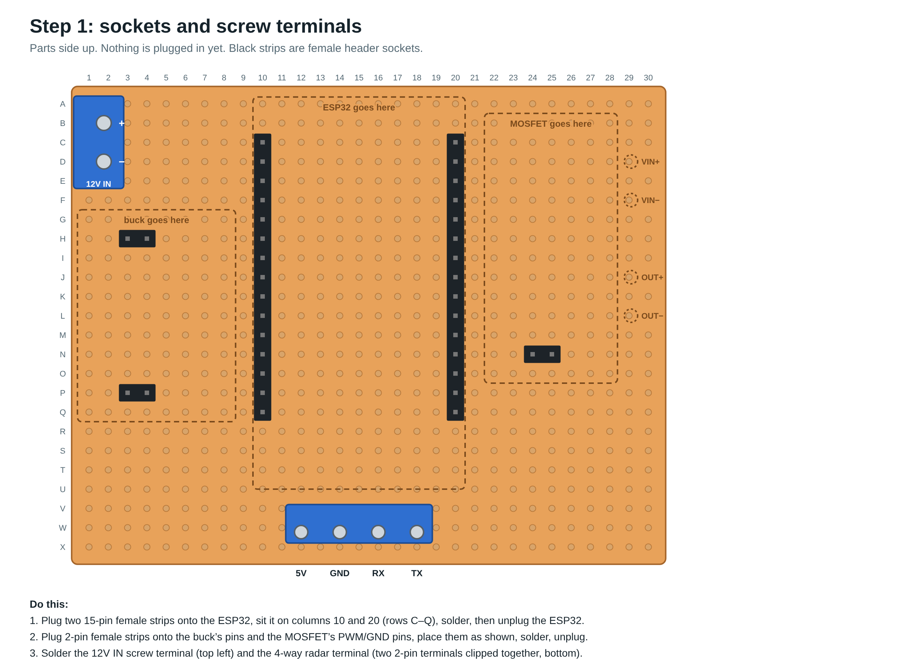
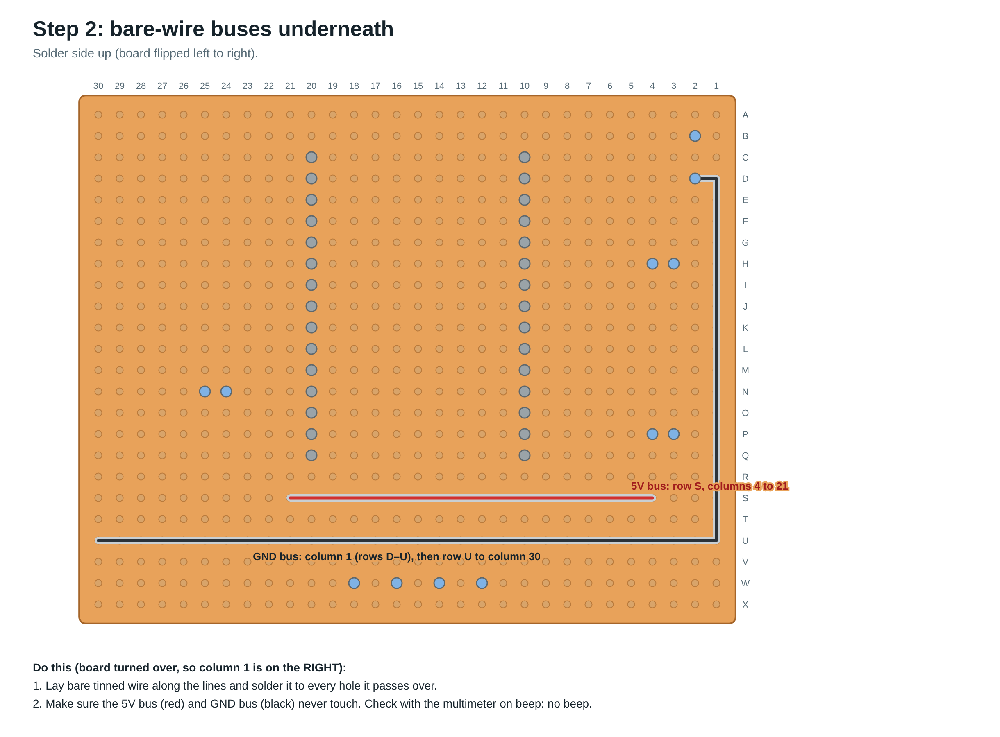
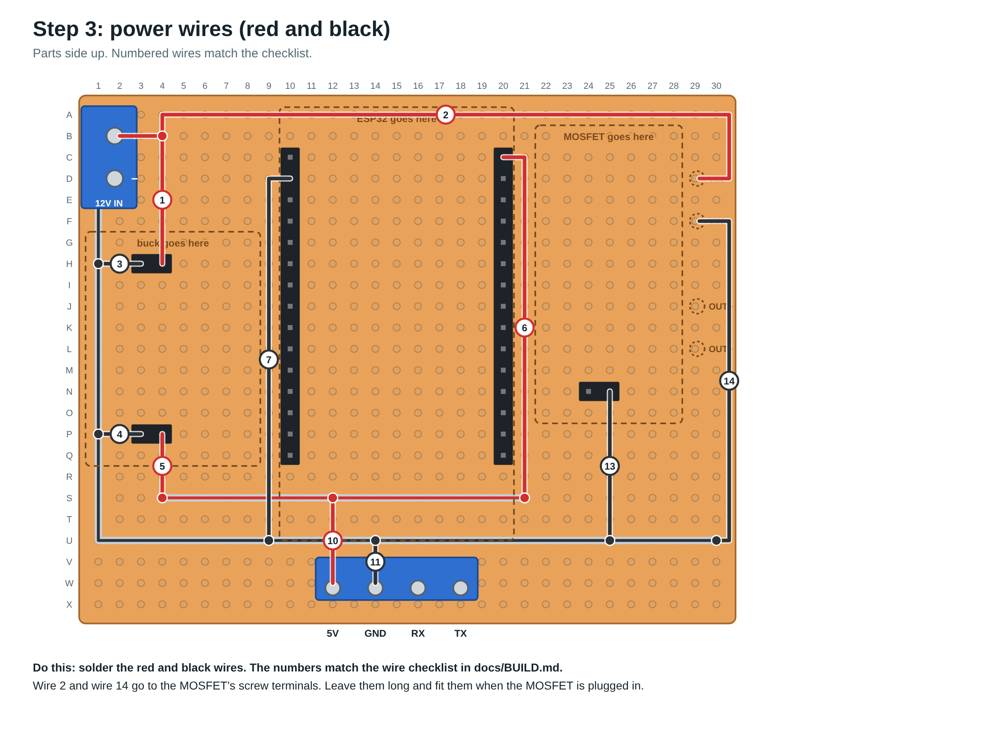
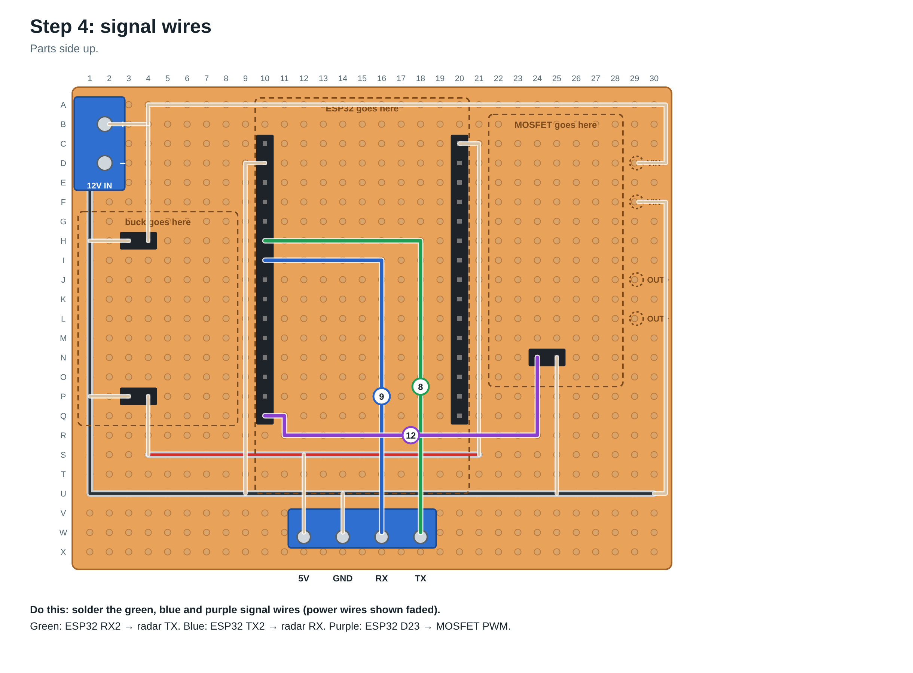
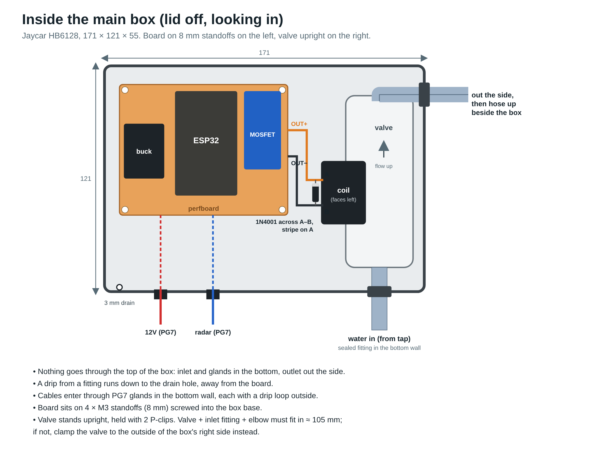
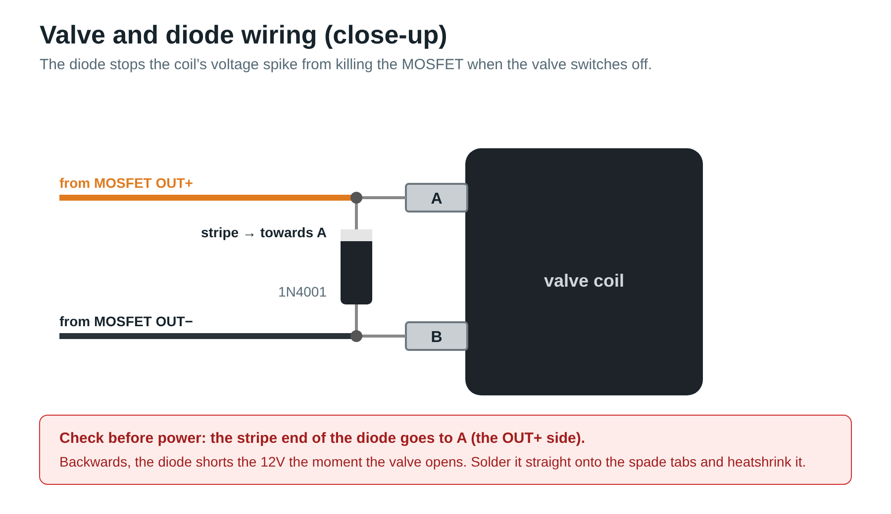
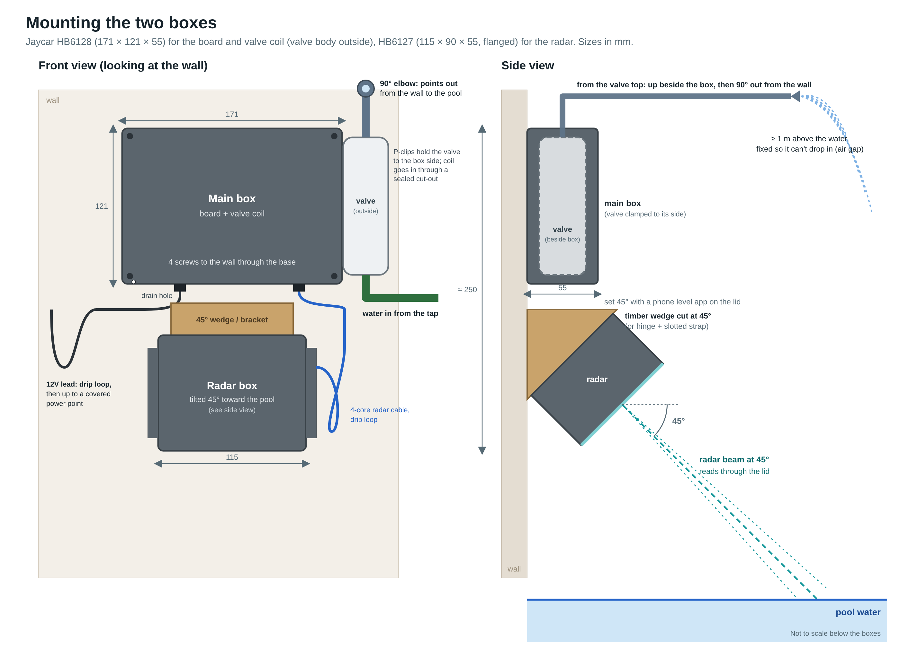

# Build guide

About 4–6 hours for a first build. Each step ends with a **Check** box. Don't move on until it passes.

Before you start, get everything on the [parts and tools list](PARTS.md).

**How to read hole positions:** the board is landscape, with columns **1–30** left to right and rows **A–X** top to bottom (parts side up). "H4" means row H, column 4. Mark a few column numbers and row letters along the board edges with a fine marker. It saves a lot of counting.

---

## Step 0: prepare the modules

1. **Buck converter (DFR1015):** check that the **5V** output pad is the one bridged with solder. It is from the factory, so don't change it.
2. Break off **4 male header pins** and solder them into the buck's **IN+, IN−, OUT+, OUT−** holes, with the long ends pointing **down**.
3. **MOSFET (HW-517):** break off **2 male pins** and solder them into its **PWM** and **GND** holes, long ends pointing **down**.

> **Check:** the buck and MOSFET each stand on their pins like a little table.

---

## Step 1: sockets and screw terminals

1. Cut two **15-pin** strips from a 1 × 20 female header. Cut through the 16th pin, which is lost, then file the cut end smooth.
2. Plug both strips onto the ESP32's pins. Sit the ESP32 on the board so the strips land in **columns 10 and 20, rows C to Q**, with the USB end at the top (row A side).
3. Turn it over and solder **one pin at each end** of both strips. Check it sits flat, then solder the rest. Unplug the ESP32.
4. Do the same for the buck (two 2-pin strips at **H3–H4** and **P3–P4**) and the MOSFET (one 2-pin strip at **N24–N25**).
5. Solder the **12V IN** screw terminal at **B2 (+)** and **D2 (−)**, with the openings facing the left edge.
6. Clip two 2-pin terminals together and solder them along the bottom at **W12, W14, W16, W18**, labelled **5V, GND, RX, TX**.

> **Check:** each module plugs in and out of its sockets without forcing.

---

## Step 2: bare-wire buses (underneath)

The board is shown **flipped over**, so column 1 is on the right.

1. **5V bus:** run bare tinned wire along **row S from column 4 to column 21**. Solder it at every hole it crosses.
2. **GND bus:** run bare wire from **D2** across to **column 1**, down column 1 to **row U**, then along **row U to column 30**. Solder it as you go.
3. Also solder the GND bus to the 12V IN **−** pin (D2).

> **Check:** multimeter on continuity (beep). Probe the 5V bus and the GND bus: **no beep**. Then probe 12V IN + and the GND bus: **no beep**.

---

## Step 3: power wires (red and black)

Solder each wire and tick it off. Where a wire meets a socket pin, push the wire through the **hole next to the pin** and join the two with solder underneath.

| ✓ | # | Colour | From | To | What it does |
|---|---|---|---|---|---|
| ☐ | 1 | red | 12V IN + (B2) | B4, then down to buck IN+ (H4) | 12V to the buck |
| ☐ | 2 | red | B4 | along row A to the right edge, then to the MOSFET **VIN+** screw | 12V to the MOSFET (fit at step 6) |
| ☐ | 3 | black | buck IN− (H3) | GND bus (H1) | |
| ☐ | 4 | black | buck OUT− (P3) | GND bus (P1) | |
| ☐ | 5 | red | buck OUT+ (P4) | 5V bus (S4) | 5V out of the buck |
| ☐ | 6 | red | ESP32 **VIN** (C20) | C21, down to the 5V bus (S21) | powers the ESP32 |
| ☐ | 7 | black | ESP32 **GND** (D10) | D9, down to the GND bus (U9) | |
| ☐ | 10 | red | radar **5V** (W12) | 5V bus (S12) | powers the radar |
| ☐ | 11 | black | radar **GND** (W14) | GND bus (U14) | |
| ☐ | 13 | black | MOSFET socket **GND** (N25) | GND bus (U25) | |
| ☐ | 14 | black | GND bus (U30) | up the right edge to the MOSFET **VIN−** screw | valve current return (fit at step 6) |

> **Check (nothing plugged in):** 5V bus to GND bus: **no beep**. 12V IN + to GND bus: **no beep**.

---

## Step 4: signal wires

| ✓ | # | Colour | From | To | What it does |
|---|---|---|---|---|---|
| ☐ | 8 | green | ESP32 **RX2 / GPIO16** (H10) | along row H to H18, down to radar **TX** (W18) | radar → ESP32 |
| ☐ | 9 | blue | ESP32 **TX2 / GPIO17** (I10) | along row I to I16, down to radar **RX** (W16) | ESP32 → radar |
| ☐ | 12 | purple | ESP32 **D23 / GPIO23** (Q10) | Q11, R11, along row R to R24, up to MOSFET **PWM** (N24) | switches the valve |

> **Check:** each wire beeps end to end, and none of them beeps to the 5V or GND bus.

The full board, both sides, is in [`wiring/one-board-layout.png`](../wiring/one-board-layout.png).

---

## Step 5: first power-up (board only)

1. Don't cut the plugpack lead yet. Plug its barrel plug into the barrel-to-screw adapter.
2. With **nothing plugged into any socket**, connect the adapter to 12V IN, + to +.
3. Switch on and measure **12V IN + to −: about 12V**. If it reads −12V, swap the wires.
4. Switch off and plug in **only the buck**. Switch on and measure **5V bus to GND bus: 4.9–5.1V**. The buck's LED is on.
5. Switch off and plug in the **ESP32** and the **MOSFET**. Switch on.

> **Check:** the ESP32's red power LED is on and nothing gets warm. If anything gets hot, switch off straight away.

---

## Step 6: flash the firmware

Follow **[ESPHOME.md](ESPHOME.md)**, then come back here.

> **Check:** Home Assistant shows the **Pool Level** device, and the **Fill Valve** switch makes the MOSFET's LED come on and go off.

---

## Step 7: prepare the boxes

The **valve body stays outside** the box, clamped upright to the box's right side. Only the **coil** comes into the box, through a sealed cut-out. No water goes inside the box.

1. Print **[drilling-template.pdf](../mounting/drilling-template.pdf)** at **100% / Actual size**, and measure the 50 mm bar to confirm the scale.
2. Hold the valve against the box's right side, upright with **flow going up** and the coil facing the box. Mark the coil's outline. The template's 30 × 30 mm square is only a guide, so **cut to suit your coil**.
3. Tape the template on and centre-punch each cross, then:
   - **Bottom face:** drill the 3 mm drain and two 12.5 mm holes for the PG7 glands (12V and radar).
   - **Right face:** drill the corners of the coil cut-out, cut between them and file it to a snug fit. Drill the two P-clip screw holes.
   - **Radar box:** drill one 12.5 mm hole for its PG7 gland.
4. Fit the glands. Sit the perfboard in the box clear of the coil, mark its 4 corner holes on the base, drill them 3 mm and fit the 4 standoffs.
5. Pull the coil's retaining clip off if it has one, push the coil through the cut-out and clamp the valve body to the outside with the two P-clips. Seal around the coil **inside and out** with neutral-cure silicone.
6. Fit the inlet fitting to the **bottom** of the valve and the hose tail to the **top**, with thread tape on both.

---

## Step 8: wire the valve and the radar

1. Inside the box, solder the **1N4001 across the coil's two tabs**, with the **stripe on A**.
2. MOSFET **OUT+** → tab **A**, MOSFET **OUT−** → tab **B**. Heatshrink both.
3. Fit wire 2 (12V) to the MOSFET's **VIN+** screw and wire 14 (GND) to **VIN−**.
4. **Radar:** in the radar box, connect the radar's 5V, GND, TX and RX to the 4-core cable and write down which colour is which. Feed the cable through both glands, then connect it to the board's radar terminal. The terminal is labelled with the **radar's** pin names, so match them name to name: radar TX → **TX**, radar RX → **RX**. (The board crosses them over to the ESP32 for you.)
5. Mount the radar with its lens **flat against the inside of the lid**. There's no hole for the lens, because the radar reads through the plastic.
6. **Power lead:** unplug the plugpack. Cut its DC lead **about 10 cm from the small barrel plug**. Slide heatshrink on, feed the long end in through the 12V gland, and rejoin it to the barrel-plug piece **stripe to stripe** (the striped wire is +). Solder, shrink, plug the barrel into the adapter and tighten the gland.

> **Check:** with the multimeter, confirm 12V IN still shows about **+12V** after rejoining. Measure the radar **TX** terminal to GND: it should be **3.3V or less**. If it reads about 5V, unplug and ask before going further, as the ESP32's pins are 3.3V only. In Home Assistant, **Distance** shows a steady number when the radar box points at the floor.

---

## Step 9: mount it

1. Screw the main box to the wall through the four holes in its base, under the lid screws.
2. Cut a **45°** end on the timber offcut and screw it to the wall about **20 mm below** the main box.
3. Fix the radar box's flange to the sloped face with the **lid facing the pool**. Lay your phone on the lid and use a level app to confirm **45°**.
4. Give both cables a **drip loop**: they should dip below the glands before going up.
5. Connect the tap hose to the **bottom** of the valve. From the **top** of the valve, run the hose **up beside the box**, then turn it **90° out from the wall** with an elbow so it sprays into the pool from about **1 m up**. Fix it so it can never fall into the water. That air gap is your backflow protection.
6. Plug the plugpack into a **covered or weatherproof** power point.
7. Fit the lids. Snug the screws evenly so the seals compress.

---

## Step 10: set up and test

1. Follow **"Set the fill levels"** in [ESPHOME.md](ESPHOME.md).
2. Turn **Fill Valve** on by hand. Water flows. Turn it off.
3. Turn **Auto Top-Up** on and watch the first automatic fill from start to finish.

---

## Troubleshooting

| Problem | Likely cause | Fix |
|---|---|---|
| ESP32 LED off | No 5V on the bus, or the buck is in backwards | Measure the 5V bus. Check the buck socket orientation |
| Buck LED off | No 12V, or the polarity is reversed | Measure 12V IN. Swap the wires if it reads −12V |
| **Distance** shows *unknown* | TX/RX swapped, or no 5V at the radar | Swap the green and blue wires at the radar terminal. Measure 5V at W12–W14 |
| **Distance** jumps around | Splashes, the wrong angle, or the lid blocking the signal | Check 45°. Bench-test through the lid. If needed, cut a lens hole and seal around it |
| Valve never opens | D23 wire, MOSFET socket, or wires 2 and 14 | Toggle **Fill Valve** and watch the MOSFET LED. Check the screws |
| MOSFET LED on but no click | Valve wiring | Check OUT+ to A and OUT− to B, and look for 12V at the tabs when it's on |
| 12V supply cuts out when the valve opens | Diode backwards (a short) | Unplug immediately and turn the diode around (stripe on A) |
| **Fill Lockout** turned on | Fill took longer than **Max Fill Time** | Look for a leak or a low tap pressure, then press **Reset Fill Lockout** |
| Water in the box | Leak around the coil cut-out or a gland | Re-seal the coil cut-out inside and out, tighten the glands, and check the drain hole is clear |
